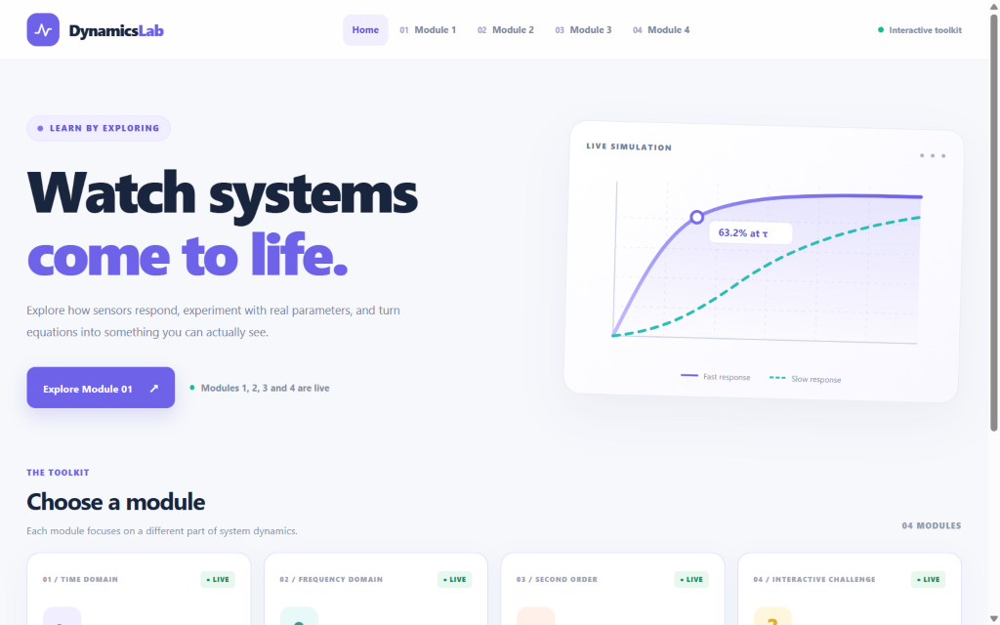
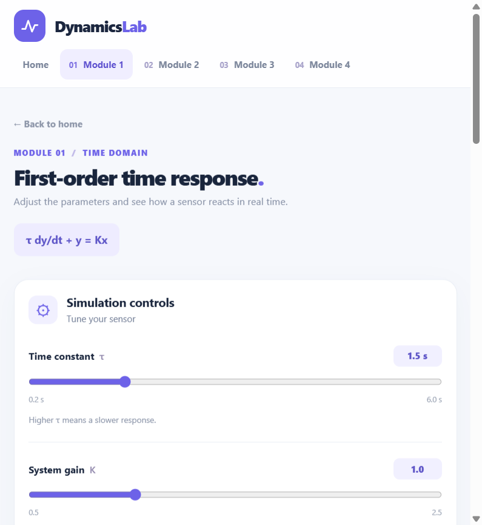
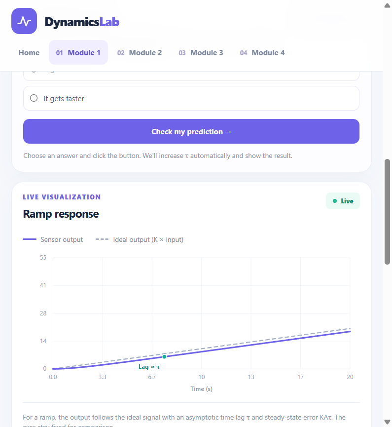
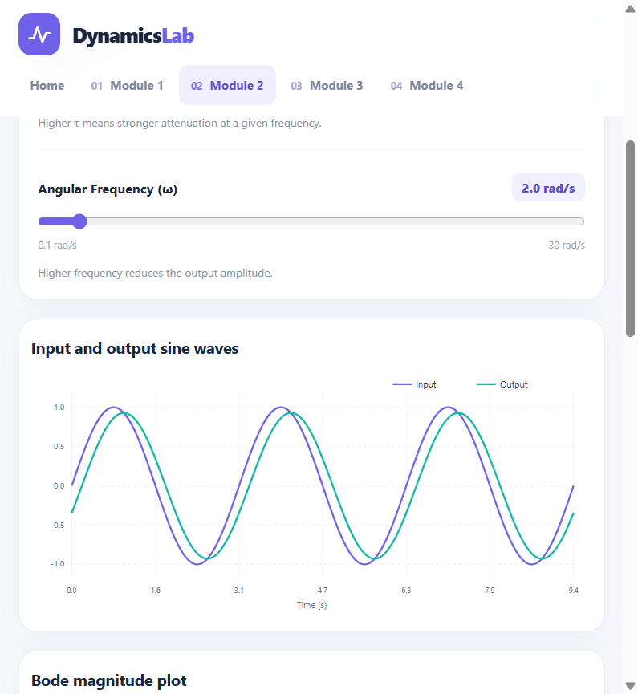
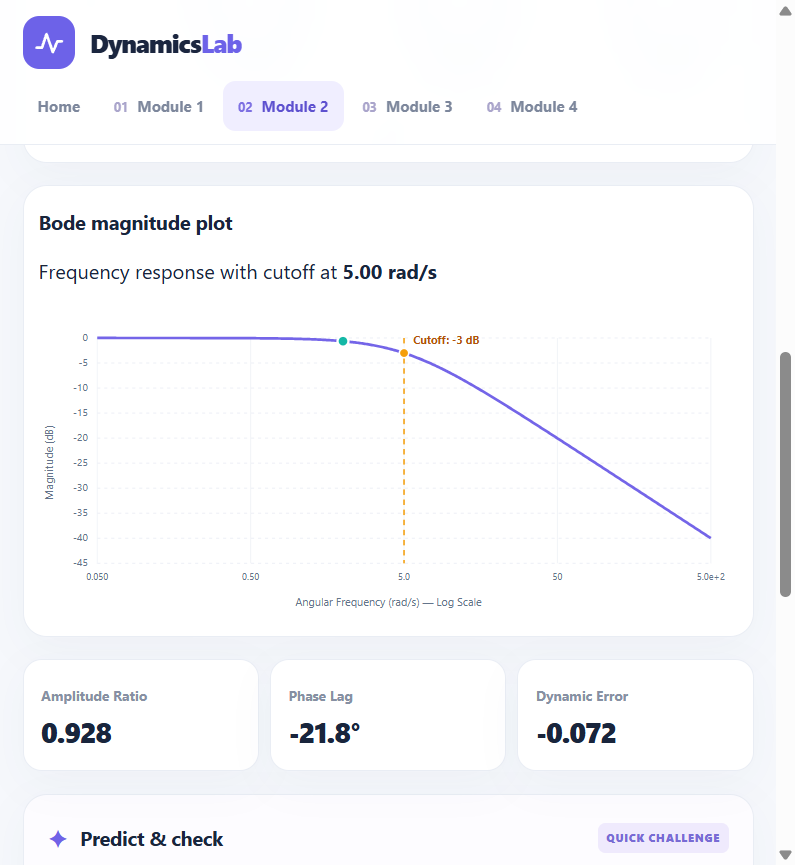
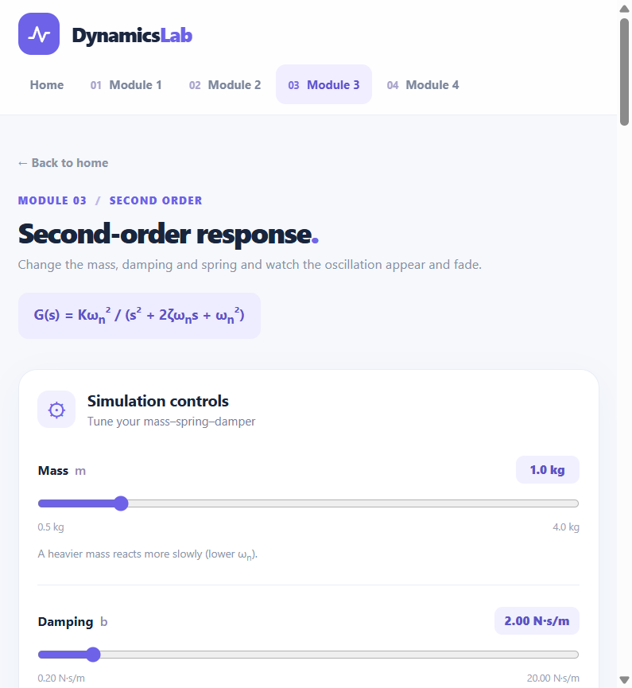
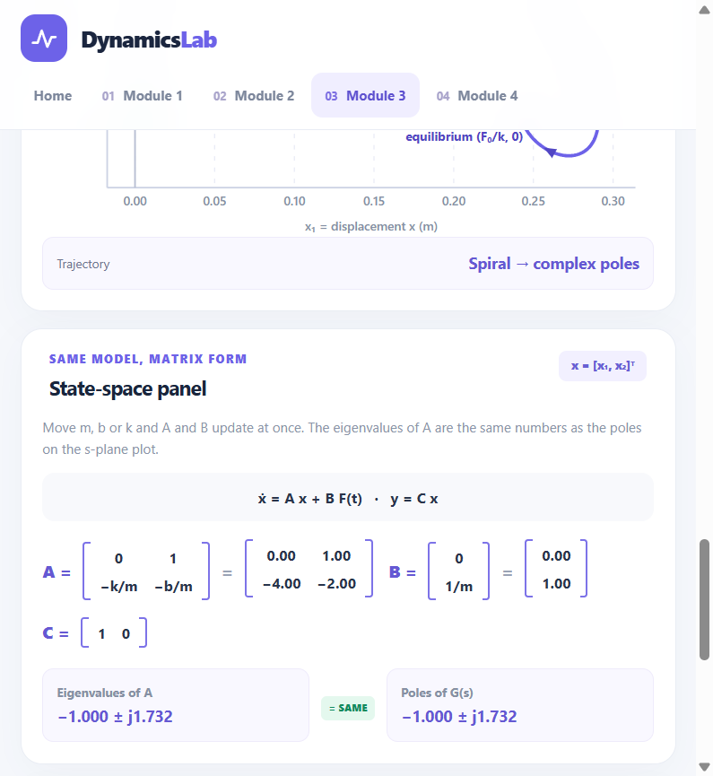
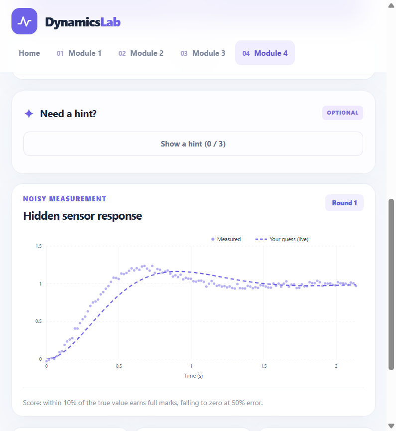
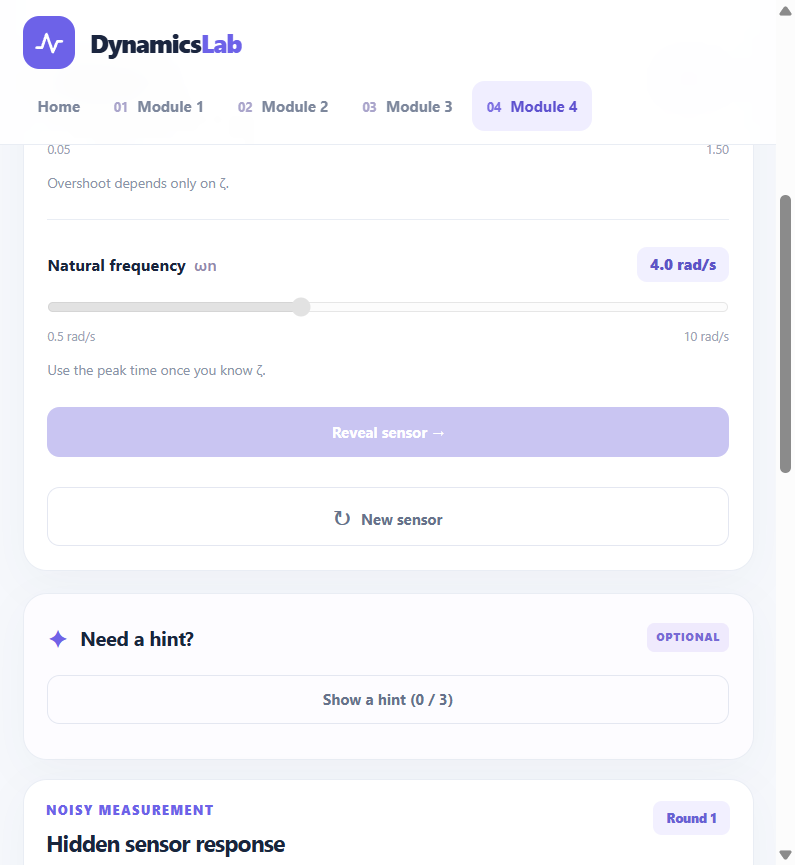
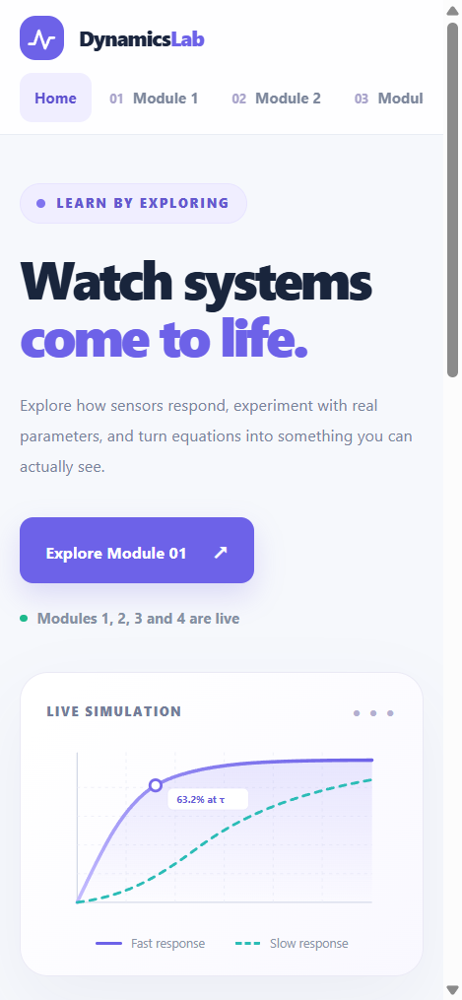

# Dynamics Lab: Interactive Dynamic Characteristics Toolkit

**ENCS4380 Interfacing Techniques, Homework 1** · Birzeit University · Instructor: Dr. Wasel Ghanem
**Group T11**

A sensor never reports the present. It reports the past, smoothed. This toolkit makes that delay visible: four interactive modules that run live in the browser, with sliders, instant plots, and a "Predict, then check" prompt in each one.

## Live demo

**https://daghlas16.github.io/ENCS4380-Dynamics-T11/**

It is a static site on GitHub Pages. Nothing needs a server, Binder, or a login, and it works on a phone.

---

## Team and module ownership

| Student | ID | Module |
| --- | --- | --- |
| Maen Khalil | 1230811 | Module 1: First-order time response |
| Malek Zeghari | 1230358 | Module 2: First-order frequency response |
| Yamen Daghlas | 1230020 | Module 3: Second-order time response (mass–spring–damper) |
| Ahmad Abu Farha | 1230318 | Module 4: "Guess the sensor" challenge |

Each module was tracked in its own GitHub Issue, assigned to its owner. Every member's work is visible in the commit history.

---

## Screenshots

### Home page


### Module 1: First-order time response



### Module 2: First-order frequency response



### Module 3: Second-order time response



### Module 4: Guess the sensor



### On a phone


---

## Modules

### Module 1: First-order time response *(Maen Khalil)*

Model: `τ·ẏ + y = K·x`, with `G(s) = K / (τs + 1)`. Think of a thermometer moving from room air into tea.

- Step and ramp inputs.
- Interactive sliders for **K** and **τ**.
- Response plot, redrawn instantly.
- Markers at **63.2 %** (at t = τ) and **95 %** (at t = 3τ).
- Ramp lag (= τ) and steady-state error (= KAτ).
- Error-fraction plot on a **logarithmic axis**. It is a straight line with slope −1/τ.
- Predict and Check interaction.
- Validation tests.

### Module 2: First-order frequency response *(Malek Zeghari)*

Model: `M = 1 / √(1 + (ωτ)²)`, `φ = −tan⁻¹(ωτ)`.

- Sliders for time constant **τ** and angular frequency **ω**.
- Input and output sine waves on one plot, showing amplitude attenuation and phase lag.
- Bode magnitude plot with the cutoff frequency `ω = 1/τ` marked.
- Live **amplitude ratio**, **phase lag**, and **dynamic error** (`δ = M − 1`).
- Shows how changing frequency and τ changes the output.
- Predict and Check interaction.
- Validation tests.

### Module 3: Second-order time response *(Yamen Daghlas)*

Model: `G(s) = K·ωₙ² / (s² + 2ζωₙs + ωₙ²)`, with a mass–spring–damper (`m`, `b`, `k`) as the physical example.

- Underdamped, critically damped, and overdamped step responses.
- Sliders for mass, damping coefficient, and spring constant.
- Natural frequency ωₙ and damping ratio ζ calculated and displayed.
- Rise time, peak time, overshoot, and settling time read live off the curve.
- Poles shown in the s-plane.
- State-space panel: `A` and `B` update live, eigenvalues of `A` sit next to the poles, and a phase-plane path (x₁, x₂) shows a spiral for underdamped and no spiral for overdamped.
- Predict and Check interaction.
- Validation tests.

### Module 4: "Guess the sensor" challenge *(Ahmad Abu Farha)*

A hidden-sensor game where the user reads a curve and works backwards to the parameters, the way an engineer does with a real sensor.

- Random sensor generation for both first-order and second-order systems.
- Random parameters: **K** and **τ** (first order), **ζ** and **ωₙ** (second order).
- Response curve displayed with a small amount of noise.
- Step responses, plus first-order sine-input responses at a stated frequency.
- Interactive input fields for the user's parameter estimates.
- First-order estimation with the **63.2 % method** and the **logarithmic method**.
- Second-order estimation using **overshoot** and **peak time**.
- **Reveal Sensor** shows the actual hidden parameters.
- The actual response curve is overlaid on the user's estimated response.
- Score based on estimate accuracy: **within 10 % earns full marks**, falling to zero at 50 % error.
- **New Sensor** button starts a new round with fresh random parameters.
- Session score and number of rounds played are tracked and displayed.
- Hints on request that explain the identification methods.

---

## Validation tests

The page checks its own maths against the values from the lecture slides. Each test shows the expected value, the calculated value, and pass or fail.

| # | Test | Expected | Module |
| --- | --- | --- | --- |
| 1 | First-order step: y(τ) and y(3τ) | 0.632·KA and 0.95·KA | 1 |
| 2 | τ = 0.2 s, input sin 2t | amplitude ratio ≈ 0.93, phase lag ≈ 21.8° | 2 |
| 3 | Signals up to 100 Hz, at most 5 % dynamic error | τ_max ≈ 0.52 ms, phase lag ≈ 9.3° at 50 Hz | 2 |
| 4 | Second order, ζ = 0.5 | overshoot ≈ 16.3 % | 3 |
| 5 | Second order, ζ = 1 | no overshoot | 3 |
| 6 | State space, m = 1, b = 2, k = 4 (ζ = 0.5, ωₙ = 2 rad/s) | eigenvalues of A = −1 ± j1.732, equal to the poles | 3 |

---

## Tech and running locally

- Static site: HTML, CSS, and JavaScript, hosted on GitHub Pages.
- All responses are closed-form formulas from the course slides, plotted live in the browser.

To run it locally, clone the repo and open `index.html` in a browser (or serve the folder with `python -m http.server`).

```bash
git clone https://github.com/daghlas16/ENCS4380-Dynamics-T11.git
cd ENCS4380-Dynamics-T11
python -m http.server 8000   # then open http://localhost:8000
```

---

## AI usage

We used AI coding assistants for: *(e.g. debugging, layout and CSS help, drafting this README)*.
Every member can explain every line of code and every equation in their own module.

---

## References

- Lecture slides: *Static and Dynamic Characteristics*, ENCS4380.
- *State-Space Modeling* notes (2026 edition), Example 3 and Sections 6 and 7.1.